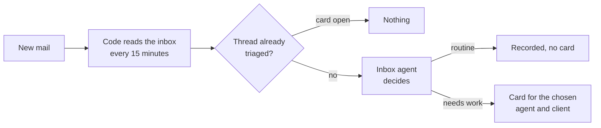

New mail to the agency's inboxes reaches the Inbox agent. For each new email thread it decides which client the mail is about and whether it needs work. Mail that needs work opens a card for the right team's agent. Routine mail opens nothing. The Inbox agent never replies: it has no tools at all, so any reply is drafted on the card and waits for the owner's yes.



## Which inboxes are read

Each inbox is listed in the `inboxes` field of the client file it belongs to, in `agents/clients/` (see [Clients and walls](/how-it-works/clients-and-walls/)). There are two kinds.

**A Gmail account connected to Nod.** Write the address. Nod reads it through the same read-only source that its background checks use, so mail that gives access to an account (sign-in codes, reset links) is hidden before the Inbox agent sees it, and known secrets are removed.

```yaml
inboxes: [contact@crowdit.ai]
```

**An inbox read through another connection's tool**, such as a support inbox behind an MCP server. Name the inbox `address`, the connected account (`connection`, its name or service as listed in Apps), the read `tool` and its `args`.

```yaml
inboxes:
  - address: support@formulaic.example
    connection: Krowdit
    tool: support_mail_gmail_search
    args:
      query: in:inbox newer_than:1d
```

Every call to that tool first passes Nod's strict read-only check, a small model request on each check, so a tool that sends, replies or changes anything is refused and nothing runs. Messages are taken from the tool's result wherever it lists objects with a thread ID (`threadId` or `thread_id`) and a sender (`from` or `sender`, or a `From` header).

Some search tools, such as Gmail's, list only each message's ID and thread ID. For those, add `read`, the tool that reads one message by its ID:

```yaml
inboxes:
  - address: support@formulaic.example
    connection: krowdit
    tool: support_mail_gmail_search
    read: support_mail_gmail_read
    args:
      query: in:inbox newer_than:1d
```

Nod then reads the newest listed message of each thread, called with `{id}`, but only for a thread that has no card yet and whose newest message wasn't already triaged, up to 20 per check. Each read passes the same read-only check.

A Gmail inbox is read from one hour before its last check, and on its first check from the last 24 hours. Up to 20 new threads per inbox are triaged on each check, oldest first; when more are waiting, the inbox's read window doesn't move, so the rest are triaged on the next check. Only the newest message of each thread is triaged. Mail the agency sent itself, marked sent or sent from the inbox's own address, is skipped.

## How the Inbox agent decides

The Inbox agent is `agents/core/inbox.md`. Its body says what counts as routine and how to pick the client and agent; edit it to change how mail is triaged. Its `tools` list must be empty. If it lists any tool, no mail is read or triaged, and each check logs the reason.

For each new thread, the Inbox agent gets the latest email (sender, subject, text and date) as untrusted data, the client whose inbox received it, every client, and every agent that can own a card with its team's routing description. It answers with one decision in one model request, made with Nod's memory model and counted in Usage as background spend. A decision that needs work names the client, the owner agent, a title, a done-when line and an estimate in agent minutes. A client that doesn't exist falls back to the inbox's own client. An agent that can't own a card, such as the Router or the Inbox agent itself, opens nothing and is retried on the next check, up to three times for the same message.

## The card

The card belongs to the chosen agent and client and runs behind that client's wall like any other card. Its first turn holds the decision's reason, the done-when line and the email as untrusted data. It runs as background work Nod started on its own, so the trust check allows reads and asks the owner before anything else, including any reply to the sender, unless the owner's notification rule or standing rules allow that action.

Each thread opens at most one card, ever: the card is keyed by the inbox and thread, and later messages in the same thread open nothing new. A thread the Inbox agent called routine is triaged again only when a new message arrives in it. Every decision is saved in the `inbox_triage` table with its reason, and each failed read or decision is logged as `inbox_triage_failed` with the inbox and the reason.

Triage runs only when agents are on (`NOD_AGENTS_ROOT` is set) and a model is connected. The code is in `src/server/agents/inbox.ts`; the upstream file it hooks into is listed in `docs/adr/0010-inbox-triage.md`.
